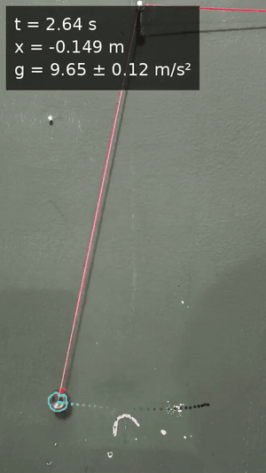
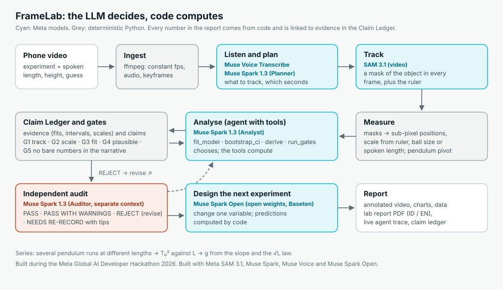
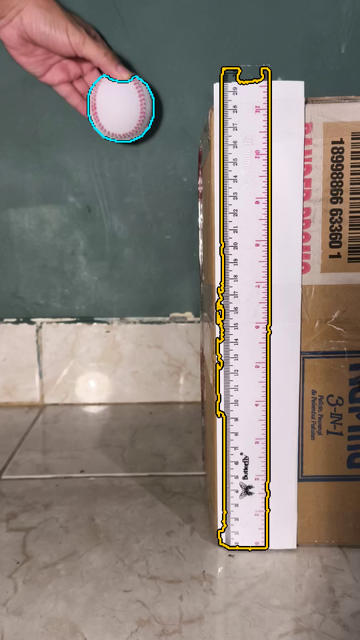
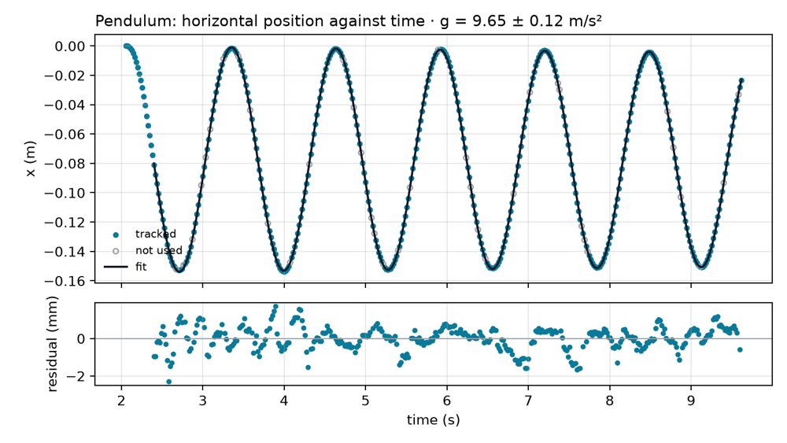

# FrameLab

**Every phone is a physics lab.** Film a simple experiment, such as a swinging pendulum or a
falling ball, and FrameLab turns the video into a measurement with an honest uncertainty. An
independent auditor checks the result, and FrameLab proposes the next experiment.

<p align="center"></p>

- **Demo video (3 min):** https://youtu.be/ym59r6SENbo
- **X post:** https://x.com/srexSetiawan/status/2117666470352269693 (please like & repost)
- **Live app:** https://framelab.popsicle.my.id (try a recorded sample; no upload needed)
- **Built during** the Meta Global AI Developer Hackathon 2026: see [`HACKATHON.md`](HACKATHON.md)

## The problem

Most students never measure physics themselves. Motion sensors and photogates are expensive,
and video-analysis tools make you click through hundreds of frames by hand. A phone camera
records everything needed, but turning the video into a trustworthy number takes tracking,
calibration, model fitting and an uncertainty analysis. FrameLab does that, explains each step,
and refuses to report a number when the recording cannot support it.

## How it works

<p align="center"></p>

| Stage | Model | Role |
|---|---|---|
| Hear the spoken lengths and the student's guess (Indonesian or English) | **Muse Voice Transcribe** | Speech → transcript with turn timings |
| Plan the experiment from the video | **Muse Spark 1.3** (Planner) | Video + transcript → what to track, the scale reference, the useful seconds |
| Track the object in every frame and find the ruler | **SAM 3.1** | The *sensor*: masks → sub-pixel positions |
| Analyse with tools (fit, bootstrap, derive, gates, claims) | **Muse Spark 1.3** (Analyst) | An agent that chooses; Python computes |
| Review the report independently | **Muse Spark 1.3** (Auditor, separate context; Muse Wonder behind a flag) | PASS · PASS WITH WARNINGS · REJECT (revise) · NEEDS RE-RECORD |
| Propose the next experiment | **Muse Spark Open** (open weights, served by Baseten); Muse Spark 1.3 as fallback | Change one variable; predictions computed by code |

### Open-weight model: Muse Spark Open via Baseten

The Designer runs on **Muse Spark Open** (`meta-models/muse-spark-open-1026`), Meta's open-weight
model, served by [Baseten](https://www.baseten.co/) through its OpenAI-compatible API
(`backend/framelab/clients/baseten.py`). It is on whenever `BASETEN_API_KEY` is set
(`FRAMELAB_DESIGNER_BACKEND=auto`; `meta` or `baseten` to force one). Baseten has no structured
outputs for this model, so the proposal comes back through a `submit_proposal` tool call and is
validated like any other agent output. If Spark Open fails, Muse Spark 1.3 finishes the step;
each proposal records which model wrote it, and the app, the report and the video credit
"Built with Muse Spark Open" only when it did. In the benchmark runs Muse Spark Open wrote the
proposals (once Muse Spark 1.3 had to finish one step).

## A verifiable agent

**The LLM decides, code computes.** Models choose what to track, which physics model to fit
and what to write. They never produce a measured number. Every value comes from a Python tool
and is stored as evidence in a **Claim Ledger**; the report's sentences use placeholders that
code fills from the ledger, and a bare number in model-written text fails gate G5.

| Gate | Checks | Example of a refusal |
|---|---|---|
| G1 Track integrity | coverage, jumps, enough points and swings | the ball was lost in too many frames (motion blur) |
| G2 Scale consistency | two independent scales agree (ruler vs ball diameter, spoken length vs pivot) | the ruler is not in the plane of motion |
| G3 Fit quality | R², residual size and structure | the fit window includes the hand |
| G4 Plausibility | the value is physically plausible; slow-motion clips saved at normal speed | g ≈ 2.4 m/s² from a 2× slow-motion clip: offers a re-run with the real frame rate |
| G5 Ledger completeness | every number in the text is a claim with evidence | a sentence with a typed-in value |

An **independent auditor** (Muse Spark in a separate context, which never saw the analyst's
reasoning) reviews the claims, the gates and the narrative. It can send the report back for
revision or ask for a new recording, with concrete tips.

<p align="center"></p>

> **Refused: "Ruler scale (0.415 mm/px) and ball-diameter scale (0.668 mm/px) disagree by
> 61.1%. The ruler is probably closer to or farther from the camera than the ball's path. Tape
> the ruler to the wall directly behind the falling ball."** — gate G2 on the trap recording.

## Benchmark

Self-recorded at home on one phone at 50–60 fps (one free-fall clip at 120 fps), reference
g = 9.781 m/s² (Jakarta).
Full table, every video and the repeat analyses: [`eval/results.md`](eval/results.md),
generated by `eval/benchmark.py` from the run records.

| | Videos | Accepted | Mean \|error\| | Max \|error\| | Reference inside 95 % CI |
|---|---|---|---|---|---|
| Pendulum (30, 40, 50 cm) | 6 | 3 | 1.44 % | 1.62 % | 3 of 3 |
| Free fall | 3 | 1 | 12.08 % | 12.08 % | 0 of 1 |
| Trap recordings (should be refused) | 2 | 1 caught | | | |

<p align="center"></p>

- **Pendulum series** (30, 40, 50 cm): the period grows as L^n with n = 0.467 ± 0.019 (theory
  0.5); g from the slope of T₀² against L is 10.4 ± 0.4 m/s² (95 % interval 9.6–11.2).
- **Same video analysed twice:** g = 9.625 and 9.622 m/s².
- The three refused pendulum videos were last analysed before fixes made on 1 November and
  were not re-run, to save API credits.
- **Free fall is the weak spot on an ordinary phone.** It needs a spatial scale and a fast
  camera. The accepted free-fall run was 12 % low; FrameLab flagged it (G4) but could not
  refuse it, because only one scale was available. The second trap was caught by G2; the first
  had no ruler of known length, so there was nothing to compare.

## Run it yourself

**Docker** (serves the API and the web app on port 8000):

```bash
docker build -t framelab .
docker run -p 8000:8000 -e MODEL_API_KEY=... -e BASETEN_API_KEY=... -v framelab-data:/data framelab
```

Without `MODEL_API_KEY` the app still serves the recorded samples (replays make no API calls)
and turns live uploads off.

**Local development** (Python 3.11+, [uv](https://docs.astral.sh/uv/), Node 20+, ffmpeg on PATH):

```bash
uv sync
uv run playwright install chromium
cp .env.example .env          # then put MODEL_API_KEY (and BASETEN_API_KEY) in .env
uv run framelab doctor        # checks ffmpeg, Chromium, API keys
uv run pytest                 # offline tests (no paid API calls)
cd web && npm install && npm run build && cd ..
uv run uvicorn framelab.api.main:app     # http://localhost:8000
```

Windows PowerShell: `.\scripts\dev.ps1 install`, `.\scripts\dev.ps1 test`, `.\scripts\dev.ps1 api`.
For frontend work run `.\scripts\dev.ps1 web` as well and open http://localhost:5173.

**Settings** (environment variables, see `.env.example`):

| Variable | Default | Meaning |
|---|---|---|
| `MODEL_API_KEY` | – | Meta Model API key; without it live uploads are off |
| `BASETEN_API_KEY` | – | Muse Spark Open for the Designer |
| `FRAMELAB_DESIGNER_BACKEND` | `auto` | `auto`, `meta` or `baseten` |
| `FRAMELAB_DEMO` | `0` | `1` = samples only, uploads off (unless `FRAMELAB_DEMO_ALLOW_UPLOAD=1`) |
| `FRAMELAB_DAILY_BUDGET_USD` | `10` | live uploads pause when today's model cost reaches it |
| `FRAMELAB_UPLOAD_LIMIT_PER_HOUR` | `10` | live runs per address per hour (replays: 30) |
| `FRAMELAB_RUNS_DIR` | `runs` | where runs are stored (`/data/runs` in Docker) |

**Samples and deployment.** `scripts/build_demo_cache.py` copies finished runs into
`demo_runs/` for the "Try a recorded sample" cards; a replay re-emits the recorded events at
4× speed and is labelled as a replay. The Dockerfile and `railway.json` deploy as one service
with a volume at `/data` (for example on Railway).

**How to record:** [`docs/recording-guide.md`](docs/recording-guide.md).

## Built during the hackathon

Everything in this repository was written between 27 October and 4 November 2026; the dated
log, the use of AI assistance and all third-party libraries, models and assets are listed in
[`HACKATHON.md`](HACKATHON.md). Patterns adapted from Meta's cookbooks are cited in code comments.

## Limitations and next steps

- Free fall is not accurate yet in our recordings: at 55 fps the ball blurs and the only scale
  was the ball's diameter, which left the result 12 % low; the 120 fps clip lost the ball in too
  many frames and was refused. A brighter scene, slow motion and a ruler of known length in the
  plane of motion are needed.
- Lengths are taken from speech; a wrong spoken value gives a wrong g. G2 can only catch it
  when a second scale exists.
- Each run costs about $0.10–0.60 in model calls.
- Next: more experiments (melting ice, springs, rolling), vibration and motion measurements in
  industry and robotics, and growth measurements in biology, all with the same rule: the model
  decides, code computes, an auditor checks.

## License

MIT. The recorded sample runs in `demo_runs/` are the author's own recordings, licensed
CC BY 4.0.
